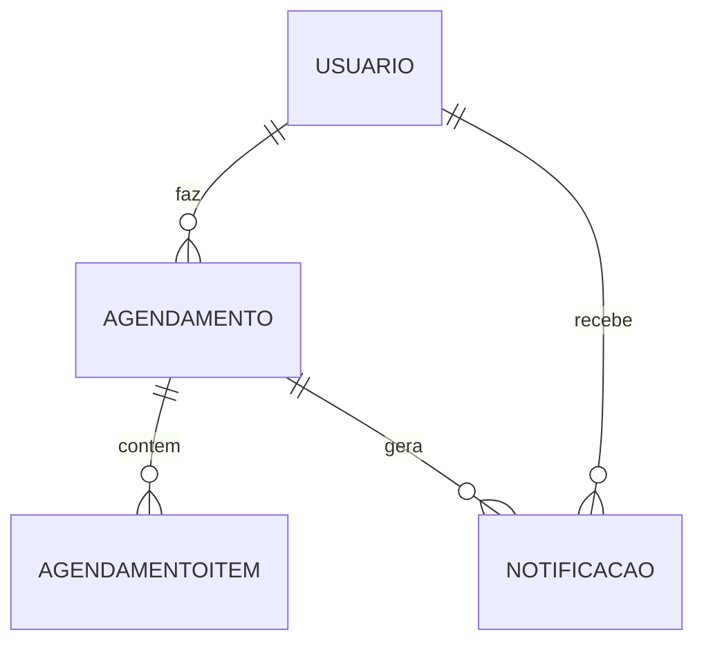

# Lizandro Barbeiro — Contexto do Trabalho #3

Disciplina: Programação Full Stack (Prof. Edécio Fernando Iepsen) — Trabalho #3: Uso das IAs no desenvolvimento de Projetos Full Stack. Apresentação: 26/11/2026.

Este documento é o "contrato" do projeto: a ideia é que ele sirva tanto de guia pra construção do backend aqui com o Claude, quanto de contexto a ser colado na conversa com o Gemini pra construir o frontend — os dois trabalhando sobre a mesma base, como se fossem equipes de back e front da mesma empresa.

## 1. O problema que o sistema resolve

A barbearia **Lizandro Barbeiro** quer parar de marcar horário por telefone/WhatsApp manualmente. O sistema permite que o cliente veja a agenda do barbeiro, escolha um dia e um horário livre, selecione o serviço desejado e confirme o agendamento sozinho — e permite que o barbeiro acompanhe sua semana, feche dias que não vai trabalhar e também cadastre manualmente um cliente que ligou ou chegou sem usar o app. MVP pensado pra **um único barbeiro** (o próprio Lizandro) — múltiplos barbeiros/funcionários ficam fora do escopo por agora, é uma extensão futura natural.

## 2. Atores e papéis

O sistema tem três papéis, guardados num único campo `role` no `Usuario` (`CLIENTE` | `BARBEIRO` | `ADMIN`):

- **CLIENTE**: entra por **cadastro simples** (nome, e-mail, senha, telefone) **ou** por **login social do Google** — os dois criam/usam o mesmo tipo de conta. É o papel padrão: toda conta nova criada pelo cadastro simples nasce como CLIENTE.
- **BARBEIRO**: conta de funcionário/dono, criada **exclusivamente pelo ADMIN** (nome, nome da barbearia, e-mail, telefone, CPF, senha) — não existe autocadastro de barbeiro. Só acessa a tela de barbeiro fazendo login tradicional e/senha, informando que é do "tipo barbeiro" no login.
- **ADMIN**: poder total sobre o sistema (criar/editar/remover barbeiros, e no futuro qualquer outra entidade). Não existe cadastro público de admin — a primeira (e por enquanto única) conta admin é criada por um script de seed, a partir de variáveis de ambiente, fora do fluxo normal da aplicação.

Regra importante de login, pra evitar confusão de permissões: o login tradicional (e-mail/senha) recebe um campo `tipo` (`"CLIENTE"` ou `"BARBEIRO"`), escolhido pela aba/tela que a pessoa está usando. O backend só deixa entrar se o `role` da conta bater com o `tipo` pedido — uma conta `BARBEIRO` só entra pedindo `tipo = "BARBEIRO"`, e uma conta `ADMIN` também usa esse mesmo `tipo = "BARBEIRO"` (é a mesma "porta de entrada" da equipe, e o que muda depois é o painel que abre, de acordo com o `role` real devolvido). Já o **login social do Google sempre devolve uma sessão de CLIENTE**, não importa o `role` que aquele e-mail já tenha salvo no banco — ou seja, se o e-mail do Lizandro (um BARBEIRO) um dia logar pelo Google, ele cai na tela de cliente normalmente, podendo agendar como qualquer cliente.

CPF: por enquanto aceita qualquer string de dígitos (sem validar dígito verificador de verdade) — decisão de escopo pra não travar o cadastro agora; a validação real de CPF fica pra uma iteração futura.

## 3. Modelo de dados

**Usuario** — id, nome, nomeBarbearia (opcional, só preenchido em contas BARBEIRO), email (único), senha (hash, nulo pra quem só usa login social), googleId (nulo, único — preenchido no primeiro login via Google), telefone (opcional), cpf (opcional, só em contas BARBEIRO/ADMIN), role (`CLIENTE` | `BARBEIRO` | `ADMIN`, padrão `CLIENTE`), criadoEm.

Observação importante: quando o **barbeiro** (ou o admin) cadastra manualmente um cliente (nome/e-mail/telefone), o backend faz um *upsert* de Usuario por e-mail — cria o registro sem senha e sem googleId. Se esse mesmo e-mail depois fizer login social de verdade pelo Google, o sistema reconhece o e-mail já existente e "assume" aquele histórico de agendamentos, em vez de criar um usuário duplicado.

**ConfiguracaoDiaSemana** — diaSemana (0 a 6), trabalhaPadrao (boolean). É o padrão semanal do barbeiro (ex.: trabalha de terça a sábado, fecha domingo e segunda). Usado só pra **gerar** os próximos dias da agenda automaticamente — não é consultado diretamente pela tela do cliente.

**DiaAgenda** — id, data (única), trabalha (boolean). É o que realmente aparece pro cliente como verde/vermelho no calendário. É gerado com base no `ConfiguracaoDiaSemana` com alguma antecedência (ex.: próximos 60 dias), e o barbeiro pode **sobrescrever um dia específico** sem mexer no padrão semanal — exatamente o caso de fechar uma terça-feira específica, mesmo trabalhando terças normalmente.

**Agendamento** — id, clienteId (FK Usuario), status (`PENDENTE_CONFIRMACAO` | `CONFIRMADO` | `CANCELADO`), criadoPorBarbeiro (boolean), tokenConfirmacao (string aleatória, usada no link de confirmação do e-mail — importante pro caso do cliente cadastrado manualmente pelo barbeiro, que pode nem ter feito login no app ainda), criadoEm, confirmadoEm (nulo até confirmar).

**AgendamentoItem** — id, agendamentoId (FK), tipoServico (`CABELO` | `BARBA` | `CABELO_BARBA` | `CRIANCA`), nomeAtendido (string — por padrão o nome do cliente, editável, ex.: "Filho - João"), dataHoraInicio (datetime), duracaoMinutos (30, exceto `CABELO_BARBA` = 60).

Um Agendamento pode ter **dois** AgendamentoItem — é o caso do cliente que agenda pra si e pro filho na mesma ida à barbearia. Como o Lizandro atende uma pessoa de cada vez, o segundo horário é sequencial (logo depois do primeiro atendimento terminar), não simultâneo — a tela de seleção de serviço, ao oferecer "agendar mais um horário", já sugere o próximo horário livre automaticamente, e os dois ficam reservados juntos no mesmo Agendamento, pra ninguém roubar o horário do meio.

**Notificacao** — id, usuarioId (FK), agendamentoId (FK, nulo), tipo (ex.: `AGENDAMENTO_CRIADO`, `AGENDAMENTO_CONFIRMADO`, `AGENDAMENTO_CANCELADO`), mensagem, requerConfirmacao (boolean — true só na notificação do cliente), confirmada (boolean), criadaEm.

### Diagrama de relacionamentos

### Como o status de cada horário é calculado (livre/ocupado/em espera)

Igual ao que foi feito no projeto anterior (Estacionamento Rotativo) pro status da sessão: **não existe um campo fixo salvo no banco pra status do horário**. Pra cada janela de 30 minutos do dia, o backend verifica se existe algum `AgendamentoItem` cujo intervalo `[dataHoraInicio, dataHoraInicio + duracaoMinutos)` sobrepõe aquela janela:

- Se sobrepõe um item de um Agendamento **CONFIRMADO** → **OCUPADO** (vermelho).
- Se sobrepõe um item de um Agendamento **PENDENTE_CONFIRMACAO** ainda dentro do prazo de validade (ex.: 15 minutos desde `criadoEm`) → **EM_ESPERA** (amarelo).
- Caso contrário → **LIVRE** (verde).
- Um pendente mais velho que o prazo é tratado como se não existisse mais (volta a aparecer como LIVRE) — sem precisar de nenhum job/cron rodando em segundo plano, só a comparação de horário no momento da consulta.

Essa mesma lógica de sobreposição resolve sozinha o caso do corte+barba (1h): ele ocupa automaticamente as duas janelas de 30 minutos que estão dentro do seu intervalo, sem precisar reservar duas linhas separadas no banco.

## 4. Fluxos funcionais principais

1. Cliente se cadastra (nome, e-mail, senha, telefone) **ou** entra com login social do Google (token validado no backend, que emite seu próprio JWT).
2. Cliente vê a agenda do barbeiro: dias do mês em verde (trabalha) ou vermelho (não trabalha).
3. Cliente clica num dia verde → vê os horários de 30 min daquele dia, em verde/vermelho/amarelo (livre/ocupado/em espera).
4. Cliente clica num horário livre → abre a tela de seleção de serviço (Cabelo / Barba / Cabelo+Barba / Criança), com a opção de adicionar um segundo atendimento (ex.: pro filho).
5. Cliente confirma a seleção (OK) → backend cria o Agendamento como `PENDENTE_CONFIRMACAO`, dispara e-mail pro cliente e pro barbeiro, e cria notificação no app pros dois (só a do cliente tem botão de confirmar).
6. Cliente clica OK na notificação (ou no link do e-mail, se ele não estiver logado no momento) → Agendamento vira `CONFIRMADO`, e passa a aparecer na agenda semanal do barbeiro.
7. Barbeiro loga (e-mail/senha, informando que é do tipo "barbeiro") e vê sua semana: hoje em destaque, os próximos 5 dias menores, com os horários ocupados/livres/reservados.
8. Barbeiro pode fechar um dia específico (mesmo que normalmente trabalhe naquele dia da semana) ou ajustar seu padrão semanal.
9. Barbeiro cadastra um cliente manualmente (nome, e-mail, telefone) num horário específico → o sistema faz todo o resto sozinho: upsert do Usuario por e-mail, cria o Agendamento, dispara e-mail + notificação + link de confirmação, exatamente como se o cliente tivesse feito pelo app.
10. Admin loga (mesma porta de entrada do barbeiro, tipo "barbeiro") e cadastra/remove contas de barbeiro (nome, nome da barbearia, e-mail, telefone, CPF, senha).

## 5. Decisões de escopo (pra não estourar o prazo)

- **Login do Google**: OAuth real simplificado — Google Identity Services no frontend (Gemini) + verificação do token no backend (Claude) com `google-auth-library`. É login social de verdade, não um mock. Client ID já criado no Google Cloud Console (projeto `lizandro-barbeiro`), compartilhado entre backend (verificação) e frontend (botão).
- **E-mail**: envio real via **Nodemailer** + conta Gmail com senha de app. Os e-mails chegam de verdade nas caixas de entrada — bom pra mostrar funcionando na apresentação.
- **WhatsApp**: fora do escopo como integração automática real (a API oficial exige verificação de empresa, inviável no prazo). Em vez disso, ao confirmar o agendamento o sistema monta um **link `wa.me`** pré-preenchido com a mensagem de confirmação, que pode ser aberto manualmente pelo cliente/barbeiro. Documentado aqui como extensão futura real (biblioteca não-oficial tipo whatsapp-web.js, ou API oficial do WhatsApp Business).
- **CPF**: validação simplificada (qualquer string de dígitos, sem checar dígito verificador) — ajuste de validação real fica pra depois.

## 6. Contrato da API (atualizado conforme a implementação avança)

| Método | Rota | Quem acessa | O que faz |
|---|---|---|---|
| POST | `/auth/cadastro` | Público | Cadastro simples de cliente (nome, e-mail, senha, telefone) |
| POST | `/auth/login` | Público | Login tradicional — body inclui `tipo` (`CLIENTE` ou `BARBEIRO`); `BARBEIRO` também serve pra contas `ADMIN` |
| POST | `/auth/google` | Público | Valida o token do Google, faz upsert do Usuario e devolve sempre um JWT de sessão `CLIENTE` |
| POST | `/admin/barbeiros` | Admin | Cadastra uma conta de barbeiro (nome, nomeBarbearia, e-mail, telefone, cpf, senha) |
| GET | `/admin/barbeiros` | Admin | Lista as contas de barbeiro |
| DELETE | `/admin/barbeiros/:id` | Admin | Remove uma conta de barbeiro |
| GET | `/agenda/dias` | Público/Cliente/Barbeiro | Lista os dias do mês com status (trabalha ou não) |
| PUT | `/agenda/dias/:data` | Barbeiro | Fecha/abre um dia específico (exceção pontual) |
| GET/PUT | `/agenda/configuracao-semanal` | Barbeiro | Consulta/define o padrão semanal de dias trabalhados |
| GET | `/agenda/dias/:data/horarios` | Público/Cliente/Barbeiro | Lista os horários de 30 min do dia com status calculado (livre/ocupado/em espera) |
| POST | `/agendamentos` | Cliente | Cria agendamento (1 ou 2 itens) a partir dos horários escolhidos |
| POST | `/agendamentos/manual` | Barbeiro | Cadastra agendamento pra um cliente informando nome/e-mail/telefone |
| POST | `/agendamentos/:id/confirmar` | Cliente (via app ou link do e-mail com token) | Confirma o agendamento — muda pra CONFIRMADO |
| POST | `/agendamentos/:id/cancelar` | Cliente ou Barbeiro | Cancela o agendamento |
| GET | `/agendamentos/meus` | Cliente | Lista os próprios agendamentos |
| GET | `/agenda/semana` | Barbeiro | Visão da semana (hoje + 5 dias seguintes) com todos os agendamentos |
| GET | `/notificacoes` | Cliente ou Barbeiro | Lista as notificações do usuário logado |

Todas as rotas protegidas (exceto `/auth/*`) esperam um header `Authorization: Bearer <token>` com o JWT emitido no login.

## 7. Stack tecnológica

**Backend (Claude)**: Node.js + Express 5 + Prisma 6 + PostgreSQL (hospedado na Neon), TypeScript, JWT + bcrypt (login tradicional), Zod 4 pra validação, `google-auth-library` (verificação do token do Google), Nodemailer (e-mails reais, conta `email.desenvolvimento.elinton@gmail.com`). Rodando com `tsx` (sem build separado por enquanto).

**Frontend (Gemini)**: React + Vite + TypeScript, consumindo exatamente o contrato de API acima, usando o Google Identity Services (gsi) pro botão de login social — mesmo Client ID do Google usado na verificação do backend.

## 8. Identidade visual e UX (importante pro Gemini)

O app precisa ser **simples e direto** — nada de elementos visuais que "poluam" a tela. Logo: `logo_2.jpeg` — emblema circular estilo placa metálica gravada (cromado sobre fundo escuro), com um barbeiro de óculos e barba, tesoura e navalha, e o texto "Barbearia para homens e meninos". O frontend deve usar esse logo na tela inicial/splash.

**Paleta de cores** (base — tons ajustáveis, mas sempre dentro dessa lógica):
- Preto (fundo principal): `#0E0E0F`
- Chumbo (superfícies, cards, header): `#2B2D31`
- Cinza escuro (textos secundários, bordas): `#4A4D52`
- Cinza claro (texto principal sobre fundo escuro): `#E4E4E6`
- **As únicas cores saturadas do app inteiro** ficam reservadas pros status da agenda: verde (livre), vermelho (ocupado), amarelo (em espera). O resto da interface é praticamente monocromático (preto/chumbo/cinza), combinando com o logo e fazendo as cores de status se destacarem exatamente onde importa.

**"Parece um app", sendo uma página web**: como a stack é React + Vite (web), a solução é simular visualmente um celular. Em telas largas (desktop — é como vai ser visto na apresentação), a página centraliza uma **moldura de celular** (phone frame: bordas arredondadas, proporção vertical tipo smartphone, ex. 390×844), com o app de verdade renderizado dentro dela, navegável clicando nos elementos internos; o restante da página (fora da moldura) é só fundo escuro/neutro. Em tela de celular de verdade (viewport estreito), a moldura some e o app ocupa a tela inteira — ali o celular real já cumpre esse papel. Se der tempo, configurar como PWA (manifesto + ícone) é um bônus que reforça a ideia de "aplicativo" (permite instalar no celular), mas não é obrigatório.

**Tela inicial (splash)**: `logo_2` centralizado em tela cheia (fundo preto/chumbo), com o texto "Toque na tela para continuar" embaixo. Ao tocar/clicar em qualquer lugar da tela, abre a escolha entre **"Sou Cliente"** e **"Sou Barbeiro"** — cada uma leva pro fluxo de login/cadastro correspondente (refletindo o campo `tipo` que a API espera no login tradicional).

## 9. Divisão do trabalho entre as IAs (o ponto central do Trabalho #3)

- **Backend**: construído com o Claude (aqui), com o Elinton digitando o código ele mesmo, seguindo orientação passo a passo — mesmo método usado no Trabalho #2 e no Estacionamento Rotativo.
- **Frontend**: construído com o Gemini, usando este documento de contexto como base (mais o arquivo `logo_2.jpeg` anexado à conversa), pra garantir que os dois "times" (back e front) estejam alinhados na mesma ideia de produto e no mesmo contrato de API.
- Elinton deve registrar, pra apresentação: quais prompts foram usados em cada IA, o que cada uma gerou, o que funcionou de primeira e o que precisou de ajuste/correção. O arquivo `lizandro-barbeiro-registro-prompts.md` (neste mesmo projeto) existe justamente pra isso.

## Status atual

Fase 2 (modelo de dados/Prisma) e Fase 3 (autenticação) concluídas e testadas no backend. Identidade visual definida (logo, paleta de cores, conceito de phone-frame pra simular app numa página web). Próximo passo: iniciar o frontend com o Gemini (Fase 7, em paralelo com o backend seguindo pra Fase 4 — lógica da agenda) usando este documento + o `logo_2.jpeg` como ponto de partida.
